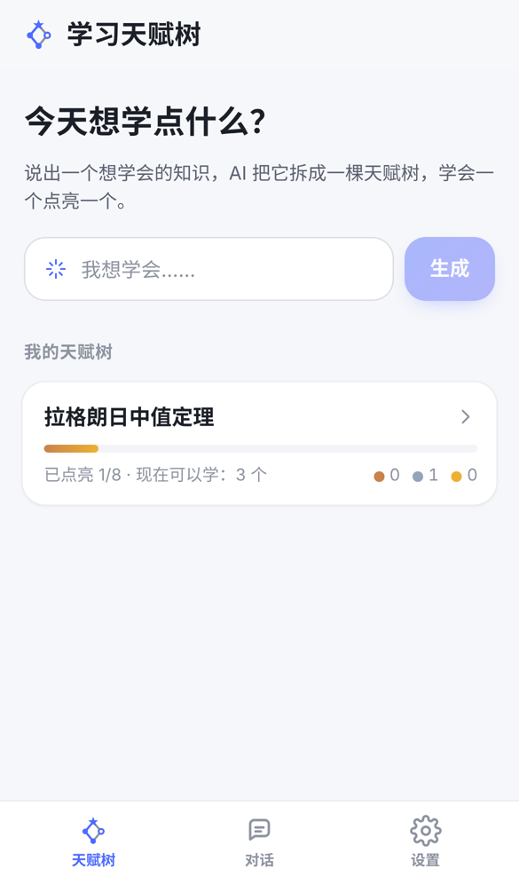
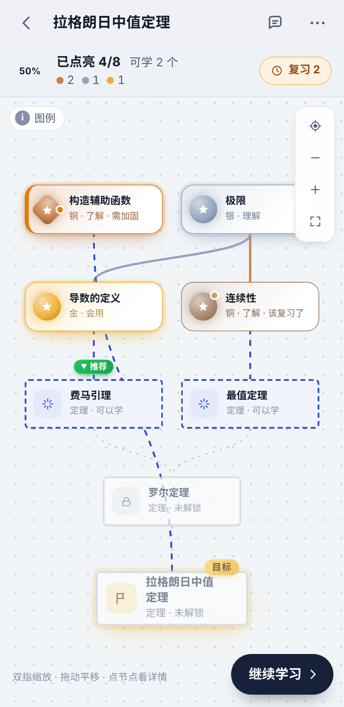
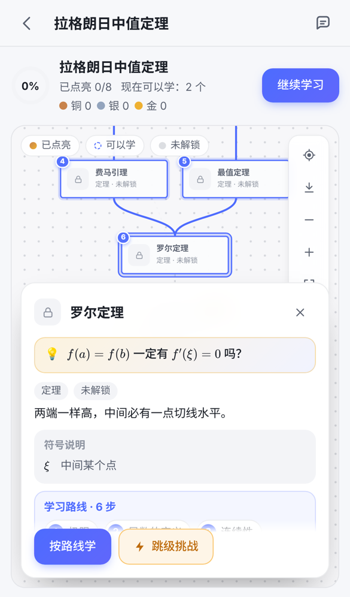
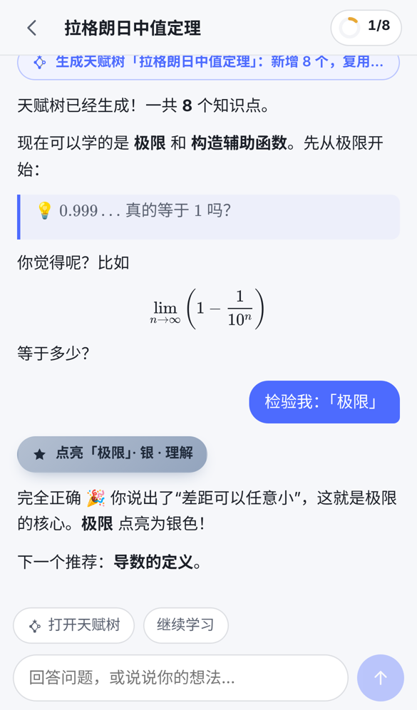

# 学习天赋树 · Talent Tree（Android / iOS App）

> **每个知识点，都连着另一个知识点。**
> AI 帮你理清想学的知识前面要先会什么，学会一个点亮一个。

**下载安卓版**：到 [Releases](../../releases/latest) 下载最新的 `talent-tree-x.y.z.apk`，在手机上打开安装（需要允许"安装未知来源应用"）。打开后在「设置」里选 AI 服务商并填 API Key。

说一句"我想学会拉格朗日中值定理"，AI 把它拆成一张前置知识图，像游戏里的天赋树一样显示出来。你通过讲解或小测证明自己会了，对应节点才会点亮（铜 / 银 / 金）。

这个 App 由 DeepSeek Harness 插件 `dsh-talent-tree` 改造而来：插件原来依赖 DSH 提供对话，现在 App 自带 AI 对话页，直接调用 DeepSeek（或任何 OpenAI 兼容接口），三个工具 `techtree_plan / techtree_record / techtree_view` 在手机本地执行，知识地图和对话都存在手机里。

| 首页 | 天赋树 | 知识点详情 | 对话里点亮 |
|---|---|---|---|
|  |  |  |  |

## 功能

- **生成天赋树**：首页输入想学的知识，AI 生成前置知识图（概念 / 定理 / 方法 / 证明思路 / 技能，形状各不同），每个点带"钩子"、白话说明和符号说明，公式用 KaTeX 排版。
- **学一遍就够**：所有目标共用一张知识地图。AI 每次都能看到你已有的知识点，同一个知识复用原来的点；名字相近时提醒 AI 确认并合并（也可以在知识点详情里手动合并），掌握程度取较高的。详情卡片会显示"也出现在"哪些目标。
- **全局知识地图**：所有目标画在一张图上，被多个目标共用的点标 🔗。
- **教学质量**：一步一问；检验题必须让学习者自己讲、算或举例；严格评判，卡住时先给提示。App 端硬性把关：点按钮后学习者还没作答不能点亮，每次作答每个点最多升一级，一次最多点亮 6 个；详情卡片显示"点亮依据"。
- **图片和 PDF**：对话里可以发照片（相册或拍照）和 PDF。PDF 文字在手机上提取（扫描版自动识别），图片由服务商的"看图模型"转写成文字后交给 AI 导师；发题目时 AI 引导你做，而不是直接给答案。
- **天赋树画布**：手机上默认按可读大小打开并对准推荐点，单指拖动、双指缩放，学习路线 ①②③、跳级挑战、点亮动画（带震动）、可上拉下拉的详情卡片、导出图片。
- **复习**：间隔重复——铜 / 银 / 金分别 3 / 7 / 21 天后该复习，每按时复习成功一次间隔翻倍（最多 16 倍），答出漏洞就从头算；详情卡片显示"几天后复习"。可以开启每日复习提醒（本地通知，到点且有该复习的内容才提醒）。
- **首页**：继续上次学习（显示下一个该学的点）、汇总所有目标的"今天要复习"、每个目标的迷你天赋树缩略图；第一次打开有新手引导。没有 API Key 也能先打开一棵示例天赋树看看，随时一键移除。
- **对话**：AI 回复可复制；最近一条回复没有改动知识地图时可以"重新回答"；对话可以改名、按标题和内容搜索；知识地图里可以搜索知识点。出错时按错误类型给出说明（Key 无效、余额不足、限流、模型名不对、对话太长…）。
- **设置**：可选 AI 服务商（默认 DeepSeek，还有通义千问、智谱 GLM、Kimi、豆包、硅基流动、OpenAI 和自定义 OpenAI 兼容接口），每家的 Key、模型、看图模型分开保存，可以从服务商拉取模型列表；显示累计 token 用量；界面语言跟随系统 / 简体中文 / English；阅读字号三档；导出导入学习数据（导入时可选合并或替换）。深色模式自动跟随系统。

## 目录结构

| 路径 | 作用 |
|---|---|
| `src/graph.js` | 纯逻辑：校验、合并、环检测、前置闭包、节点状态、复习间隔、导入合并 |
| `src/tutor.js` | 教学规则提示词、三个工具的 schema 和本地执行（原插件 `index.js` 的移植） |
| `src/ai.js` | OpenAI 兼容的流式对话客户端 + 工具调用循环 |
| `src/providers.js` | 可选的 AI 服务商列表（地址、常用模型、看图模型、获取 Key 的网址） |
| `src/attachments.js` | 图片和 PDF：读取、PDF 文字提取、看图模型转写 |
| `src/storage.js` | 手机本地存储：知识地图和对话存文件，设置存 Preferences，API Key 存系统密钥库；浏览器里都用 localStorage |
| `src/reminders.js` | 每日复习提醒（本地通知） |
| `src/dialog.js` | App 内的确认 / 输入 / 选择对话框 |
| `src/demo.js` | 示例天赋树（网页预览版自动载入，手机上可手动打开和移除） |
| `src/tree.js` / `src/tree.css` | 天赋树画布（原插件 `client.js` 的移植，加了双指缩放和原生分享） |
| `src/screens/` | 首页、天赋树、知识地图、对话、对话列表、设置、新手引导、合并知识点、对话框、出错页 |
| `src/i18n.js` | 中文 / 英文界面文字 |
| `android/` `ios/` | Capacitor 生成的原生工程 |
| `assets/` | 图标和启动图源文件（`npm run assets` 生成各尺寸） |
| `test/` | `npm test` 单元测试（Node 22+）；`test/e2e/` 浏览器冒烟测试 |

## 开发

需要 Node.js 22 或更高版本。

```bash
npm install
npm run dev      # 在电脑浏览器里预览（用手机尺寸看：F12 → 切换设备模式）
npm test         # 跑单元测试
npm run lint     # 代码检查
npm run test:e2e # 用浏览器把主要页面走一遍（需要 Playwright 的 Chromium：npx playwright install chromium）
```

第一次打开先到「设置」选 AI 服务商并填 API Key（默认 DeepSeek，在 https://platform.deepseek.com/api_keys 获取）。各家模型名更新很快，设置里列的是常用的几个，其他的可以直接输入。

## 打包安卓

1. 安装 [Android Studio](https://developer.android.com/studio)（自带 JDK 和 Android SDK）。路径里有中文（比如「插件」文件夹）时安卓打包偶尔会出怪错，已在 `android/gradle.properties` 里放行；真遇到问题就把整个文件夹挪到纯英文路径，比如 `C:\dev\talent-tree`。
2. 在本文件夹运行：
   ```bash
   npm install
   npm run android   # 构建网页、同步到安卓工程、打开 Android Studio
   ```
3. Android Studio 里点 ▶ 装到手机或模拟器上试用。
4. 上架用的安装包：菜单 **Build → Generate Signed App Bundle / APK** → 选 **Android App Bundle (.aab)** → 新建签名密钥（**密钥文件和密码一定要备份，丢了就再也无法更新这个 App**）。

每次改了 `src/` 里的代码，重新运行 `npm run sync` 再在 Android Studio 里运行。

## 用 GitHub 自动打包安卓

仓库里的 `.github/workflows/android.yml` 会在 GitHub 的服务器上打包，不用自己装 Android Studio：

- **发一个新版本**：在 GitHub 网页上进入 **Releases → Draft a new release**，在 "Choose a tag" 里输入新版本号（比如 `v1.0.1`，必须以 `v` 开头）并选择创建，然后点 **Publish release**。大约 5–10 分钟后，签好名的 `.apk`（给用户下载安装）和 `.aab`（上传 Google Play 用）会自动出现在这个 Release 下面。
- **只想试打一个包**：进入 **Actions → Android APK → Run workflow**，跑完后在这次运行的 Artifacts 里下载。
- 签名用的是仓库 Secrets 里的 4 个值（`ANDROID_KEYSTORE_BASE64`、`ANDROID_KEYSTORE_PASSWORD`、`ANDROID_KEY_ALIAS`、`ANDROID_KEY_PASSWORD`）。密钥文件本身只在你电脑的 `release-key/` 文件夹里，不会上传到仓库，**一定要另外备份**：丢了就无法再给已安装的用户发更新。

## 打包 iOS

> 目前只支持安卓。iOS 工程保留着，但 1.2 新增的原生插件（密钥存储、本地通知）还没同步进去，也没有在 iPhone 上测过。以后要做 iOS 时先运行 `npx cap sync ios`。

iOS 必须在 Mac 上用 Xcode 打包：

```bash
npm install
npm run ios      # 构建、同步到 iOS 工程、打开 Xcode
```

Xcode 里选择你的开发者团队（Signing & Capabilities），连上 iPhone 运行；上架用 **Product → Archive** 上传到 App Store Connect。

## 上架前清单

- **App ID**：现在是 `com.tao.talenttree`（在 `capacitor.config.json`、`android/app/build.gradle` 的 `applicationId`、Xcode 的 Bundle Identifier 里）。上架后不能改，想换现在就换。
- **版本号**：每次上传新版本，把安卓 `android/app/build.gradle` 的 `versionCode` 加 1、`versionName` 改成新版本；iOS 在 Xcode 里改 Version / Build。
- **图标**：替换 `assets/icon-only.png`（1024×1024）等文件后运行 `npm run assets`。
- **隐私政策**：`PRIVACY.md` 已按 1.2 的实际情况写好，App 的「设置 → 关于 → 隐私政策」打开的是它在 GitHub 上的页面（地址在 `src/screens/Settings.jsx` 的 `PRIVACY_URL`）。发布前把里面的【更新日期】【邮箱】填上，商店后台填同一个网址。
- **Google Play 的生成式 AI 要求**：Play 要求生成式 AI 应用提供应用内举报 / 标记不当内容的入口，目前还没有做，上架 Google Play 前需要补上（国内商店的要求以各家后台为准）。
- **Google Play 数据安全表单**：按 `PRIVACY.md` 第三、四节填写：数据不经开发者，对话内容和图片会发送给用户选择的第三方 AI 服务商。
- **AI 服务的 Key**：现在需要用户自己填 DeepSeek API Key，普通用户门槛较高，审核也可能因为"需要额外账号才能用"被问到。正式上线建议搭一个自己的后端转发服务（Key 放在服务器上，可以加登录和用量限制），然后把 `src/storage.js` 里的默认 `baseUrl` 改成你的服务器地址。
- **商店账号**：Google Play 开发者账号一次性 25 美元，新个人账号需要先做封闭测试（一定数量的测试者、持续一段时间）才能正式发布；Apple 开发者计划每年 99 美元。
- **中国大陆上架**：国内安卓商店（华为、小米、OPPO、vivo 等）一般要求 APP 备案，很多还要软件著作权；面向公众提供生成式 AI 服务还涉及相关备案或登记，App Store 中国区对 AI 类 App 也有类似要求。具体要求变化较快，提交前请到各商店开发者后台核实。

## 数据存放

- 知识地图和对话：App 私有目录里的 JSON 文件（每个对话一个文件，先写临时文件再改名，写到一半断电也不会损坏）。1.1 及以前存在 Preferences 里的数据，升级后第一次打开时自动搬过来。
- 设置：Capacitor Preferences（不含 API Key）。
- API Key：`@aparajita/capacitor-secure-storage` 加密保存，密钥在 Android Keystore 里；系统备份不包含它（见 `android/app/src/main/res/xml/` 里的备份规则），换机后需要重填。
- 对话内容会发给你在设置里配置的 AI 服务商，不会发到其他地方。
- 「设置 → 导出学习数据」把知识地图和全部对话存成 JSON 备份（不含 Key），换手机后再导入，可以选择合并或替换。

## 许可

© 2026 Tao，保留所有权利。源码公开供查看和学习；未经作者许可，不得复制、修改后发布或用于商业用途。详见 [LICENSE](LICENSE)。
